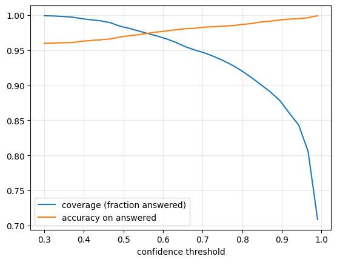
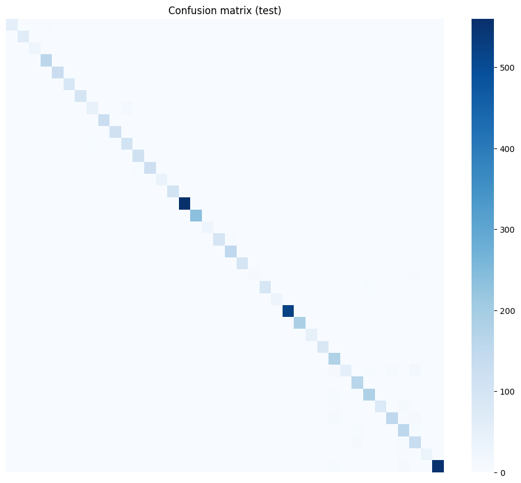

# 🌿 Crop Disease Detector

**Offline, uncertainty-aware plant disease detection from a single leaf photo.**


<!-- Add after deploying: **[Live demo](https://YOUR-APP.streamlit.app)** -->

## Overview
Smallholder farmers often notice crop diseases too late, and expert help is scarce where internet access is poor. This project classifies **38 plant disease / healthy classes** from a phone photo using a compact MobileNetV2 model that runs **fully offline** (TensorFlow Lite) and **says "uncertain, ask an expert" instead of guessing** when confidence is low.

## Key results
Held-out test set (5,430 images, PlantVillage):

| Metric | Value |
|---|---|
| Test accuracy | **95.9%** |
| Macro-F1 | 0.947 |
| Coverage at confidence ≥ 0.80 | 92.0% of photos |
| Accuracy on answered photos | **98.7%** |
| Model size (dynamic-range quantized) | **2.58 MB** (fp32: 9.08 MB) |

<p align="center">
  
  
</p>

## Features
- **Transfer learning:** MobileNetV2 (ImageNet) with augmentation and two-stage fine-tuning
- **Uncertainty-aware:** abstains when max softmax probability < 0.80 or prediction entropy is high
- **On-device ready:** quantized TFLite model, about 3.5x smaller than fp32 with ~0.4% accuracy change on a 500-image check
- **Simple UI:** Streamlit app with camera or upload input and top-3 predictions
- **Deployable:** Streamlit Community Cloud, Docker, or embed the `.tflite` file in an Android app

## Project structure
```
crop-disease-detector/
├── crop_disease_detector.ipynb   # Colab notebook: full pipeline with outputs
├── train.py                      # Script version: train, evaluate, export
├── requirements-train.txt
├── deploy/                       # Streamlit app + model
│   ├── app.py
│   ├── model.tflite
│   ├── labels.json
│   ├── requirements.txt
│   └── Dockerfile
├── figures/                      # Result plots used in the report
├── REPORT.md                     # Full project report
└── README.md
```

## Quick start
**Run the app locally**
```bash
cd deploy
pip install -r requirements.txt
streamlit run app.py
```

**Docker**
```bash
cd deploy
docker build -t crop-doctor .
docker run -p 7860:7860 crop-doctor
```

**Retrain**
```bash
pip install -r requirements-train.txt
python train.py          # or open the notebook in Google Colab (GPU)
```
The reported numbers come from the notebook run; `train.py` is a condensed version and may differ slightly.

**Deploy for free:** Streamlit Community Cloud → select this repo → main file `deploy/app.py`.

**Android:** use `model.tflite` + `labels.json` with TensorFlow Lite. Input is 224×224 RGB float32 in the 0–255 range (scaling is inside the model); output is 38 probabilities.

## Method
1. **Data:** PlantVillage (about 54k images, 38 classes), 80/10/10 split with a fixed seed
2. **Model:** MobileNetV2 + global average pooling + dropout + softmax; head trained first, then the last 30 layers fine-tuned
3. **Uncertainty:** confidence threshold and entropy check, with the threshold chosen from the coverage-accuracy curve
4. **Compression:** TFLite dynamic-range quantization

See [`REPORT.md`](REPORT.md) for details, per-class analysis, and discussion.

## Limitations
- PlantVillage images are lab-style; **accuracy on real field photos is likely lower** and was not measured
- Random-noise images averaged 0.86 confidence (above the 0.80 threshold), so confidence alone does not reject non-leaf input; a leaf/not-leaf gate is planned
- The tool gives **no treatment advice** and does not replace expert diagnosis
- Weakest class: tomato early blight (recall 0.53)

## Roadmap
- [ ] Fine-tune on PlantDoc / field photos and report lab vs field accuracy
- [ ] Leaf / not-leaf rejection model
- [ ] Probability calibration (temperature scaling)
- [ ] Android app and Arabic/English interface

## Author
**Yahya Majrashi**, Diploma in Data Science and AI at Tuwaiq Academy

## References
- Hughes & Salathé (2015), *An open access repository of images on plant health*
- Sandler et al. (2018), *MobileNetV2: Inverted Residuals and Linear Bottlenecks*
- Singh et al. (2020), *PlantDoc: A Dataset for Visual Plant Disease Detection*
