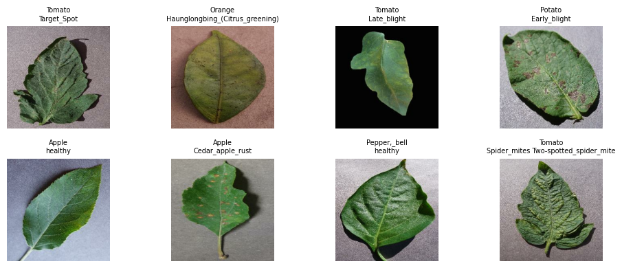
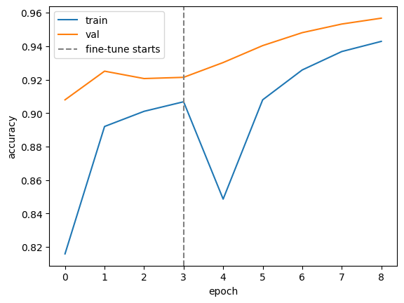

# Offline, Uncertainty-Aware Crop Disease Detection from Smartphone Photos

**Author:** Yahya Majrashi  |  **Field:** Artificial Intelligence & Data Science  |  **Date:** October 2026

## Abstract
Smallholder farmers often detect crop diseases too late. This project builds a compact image classifier that identifies 38 plant disease/healthy classes from leaf photos, runs fully offline on a phone via TensorFlow Lite, and abstains ("uncertain, ask an expert") when its confidence is low. Results: test accuracy 95.9%, macro-F1 0.947, and a 2.58 MB quantized model. With abstention at a 0.80 confidence threshold, the model answers 92.0% of photos with 98.7% accuracy on those answered.

## 1. Problem and Motivation
Crop diseases cause major yield losses, and expert diagnosis is scarce in rural areas with poor connectivity. A wrong confident diagnosis can lead to wasted or harmful treatment, so a useful tool must be (a) available offline, (b) lightweight, and (c) honest about uncertainty.

## 2. Objectives
1. Classify leaf diseases with high accuracy using transfer learning.
2. Compress the model for on-device inference.
3. Add a confidence-based abstention mechanism and quantify its trade-off.
4. Deploy a usable app (web and mobile-ready).

## 3. Data
PlantVillage (via TensorFlow Datasets): ~54k images, 38 classes, split 80/10/10 (train/val/test) with a fixed seed. Images are lab-style with plain backgrounds, which limits realism (see Limitations).

## 4. Method
- **Model:** MobileNetV2 (ImageNet weights), global average pooling, dropout 0.3, softmax head.
- **Augmentation:** flips, rotation, zoom, contrast (to improve robustness to phone photos).
- **Training:** stage 1 trains the head (lr 1e-3); stage 2 fine-tunes the last 30 layers (lr 1e-5); early stopping on validation accuracy.
- **Uncertainty:** abstain if max softmax probability < 0.80 or prediction entropy > 1.0. Threshold chosen from the coverage-accuracy curve.
- **Compression:** TFLite dynamic-range quantization (~4x smaller than fp32).

## 5. System and Deployment
Streamlit app (camera/upload) running the TFLite model, packaged with Docker (port 7860) for Hugging Face Spaces or any host. The same `.tflite` file can be embedded in an Android app. Input: 224x224 RGB float32 (0-255); scaling is inside the model.

## 6. Results
All metrics are on the held-out test set (5,430 images, 10% of PlantVillage) unless stated otherwise.

| Metric | Value |
|---|---|
| Test accuracy | 95.9% |
| Macro-F1 / Weighted-F1 | 0.947 / 0.958 |
| Coverage at threshold 0.80 | 92.0% |
| Accuracy on answered images | 98.7% |
| TFLite size (fp32 / fp16 / dynamic) | 9.08 / 4.60 / 2.58 MB |
| TFLite accuracy, 500 test images (fp32 / dynamic / fp16) | 95.0% / 94.6% / 94.8% |
| CPU latency per image, Colab (fp32 / dynamic / fp16) | 17.5 / 20.9 / 8.9 ms |

*Figure 1. Sample images from the dataset.*

*Figure 2. Training and validation accuracy; the dashed line marks the start of fine-tuning.*

*Figure 3. Confusion matrix on the test set (38 classes).*

*Figure 4. Coverage and accuracy on answered images as the confidence threshold increases.*

**Weakest classes.** `Tomato___Early_blight` had the lowest recall (0.53, F1 0.67), followed by `Tomato___Target_Spot` (F1 0.84). Most other classes exceeded F1 0.88.

**Out-of-distribution check.** Random-noise images received a mean confidence of 0.86, above the 0.80 threshold, while real test images averaged 0.96. Mean entropy separated the two better (0.49 for noise vs 0.14 for real images), which is why the app checks both confidence and entropy.

## 7. Discussion
The abstention mechanism trades coverage for reliability: at the 0.80 threshold the model answers 92.0% of photos with 98.7% accuracy on those answered, compared with 95.9% when it answers every photo. Dynamic-range quantization reduced the model from 9.08 MB to 2.58 MB (about 3.5x smaller) with a small accuracy change on the 500-image check (95.0% to 94.6%). The fp16 model was the fastest on the Colab CPU (8.9 ms), but latency on phone hardware was not measured. The weakest class, early blight on tomato, is likely confused with other tomato diseases that look similar, but this explanation was not verified; the confusion matrix should be inspected to confirm it.

## 8. Limitations
- PlantVillage is lab-style; accuracy on field photos is likely lower and has not been measured here.
- Softmax confidence is overconfident on non-leaf input: random noise averaged 0.86 confidence, above the 0.80 threshold. Entropy helps, but a dedicated leaf/not-leaf gate is recommended.
- The tool gives no treatment advice and must not replace expert confirmation.
- Covers only the 14 crops and 38 classes in the dataset.

## 9. Future Work
Fine-tune on PlantDoc or self-collected field photos and report lab vs field accuracy; temperature-scaling calibration; leaf/not-leaf gate; Arabic/English UI; Android app; add regional crops and diseases.

## 10. Conclusion
The system shows that a small, quantized, uncertainty-aware model can deliver practical offline plant-disease screening, with honest abstention as a safety feature.

## References
1. Hughes & Salathe (2015). An open access repository of images on plant health. arXiv:1511.08060.
2. Sandler et al. (2018). MobileNetV2: Inverted Residuals and Linear Bottlenecks. CVPR.
3. Singh et al. (2020). PlantDoc: A Dataset for Visual Plant Disease Detection. CoDS-COMAD.
4. Guo et al. (2017). On Calibration of Modern Neural Networks. ICML.
